## Sobre

Gerente de TI com trajetória em suporte, coordenação e gestão de equipe técnica. Em paralelo, desenvolvo de forma independente mais de 20 aplicações e protótipos full-stack, muitos com IA aplicada: classificação automática, RAG, análise em tempo real e automação de atendimento. Cursando Ciência da Computação (UDF, 4º semestre).

