## Sobre

Desenvolvedor full stack e de IA aplicada em Brasília. Fiz carreira em TI do suporte à gerência e, em paralelo, construí 27 projetos full-stack, a maioria com IA aplicada a um problema real: classificação automática de documentos, RAG, análise de conversas em tempo real e automação de atendimento. Cursando Ciência da Computação (UDF, 4º semestre).

### Código aberto

| Projeto | O que é |
|---|---|
| [Colheita Urbana](https://github.com/pedrodereky/colheita-urbana) | Logística de doação de alimentos com rastreio da entrega ao vivo; Node.js e SQLite nativo, sem dependências npm |
| [BriefBot](https://github.com/pedrodereky/briefbot-plataforma-de-reuni-es) | Reuniões com vídeo, transcrição ao vivo e resumos com itens de ação gerados por IA |
| [Wasabii Art](https://github.com/pedrodereky/project-canvas) | Modelagem 3D de vestuário no navegador, do molde 2D à peça no avatar |
| [Arq3D Studio](https://github.com/pedrodereky/arch3d-studio-space) | Da foto ou planta ao modelo 3D pronto para Lumion, SketchUp e Revit |
| [Peticionamento com IA](https://github.com/pedrodereky/peticionamento-com-ia) | Gestão de escritório jurídico com peças geradas por IA e integração com o DataJud do CNJ |
| [Diário Oficial Scanner](https://github.com/pedrodereky/scanner-de-diario-oficial) | Monitora diários oficiais, classifica publicações com IA e alerta por WhatsApp |
| [Equilíbrium](https://github.com/pedrodereky/equilibrium-maker) | Jogo educativo de árvores AVL em que o jogador faz cada rotação |

